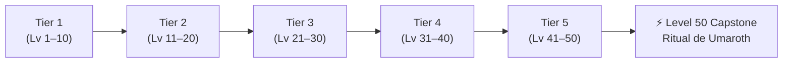
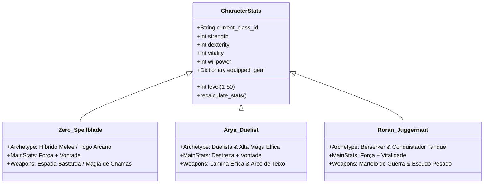
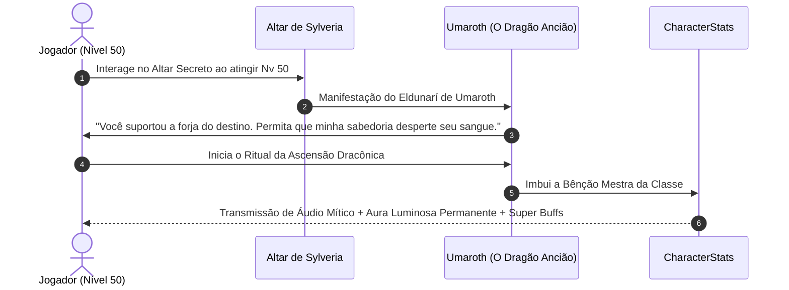

# 📜 Playbook Arquitetural: Classes, Sets, Progressão de Dragões/Pets e Expansão de Level Cap
> **GameZero RPG Framework** • Versão 1.0 (Level Cap 50) • Alagaësia Engine

---

## 1. Visão Geral e Arquitetura de Tiers (Level Cap 50)

O sistema de progressão do **GameZero** segue a estrutura de **Faixas Decimais (Tiers de 10 Níveis)** inspirada nos clássicos ARPGs (*Diablo II/III*, *MU Online*, *Grim Dawn*):



### Regras de Drop Global & Exceções:
1. **Drops Progressivos (Tiers 1 a 5):** Mobs dropam equipamentos da sua respectiva faixa de nível.
2. **Sets Lendários (Dourados):** Podem dropar de qualquer criatura em qualquer nível com chance base de `0.5%` em mobs normais e `8% a 12%` em Chefes.
3. **Sets Divinos (Prismáticos / Vermelhos):** Drops ultra-raros globais com chance de `0.05%` (1 em 2.000) em mobs normais e `1% a 2%` em Chefes Mundiais. Possuem atributos cósmicos e efeitos passivos transcendentes.

---

## 2. As 3 Classes Fundamentais e Identidade de Combate



### A. Zero (O Cavaleiro de Dragão)
* **Arquétipo:** *Spellblade Híbrido* (Melee Físico / Fogo Arcano).
* **Atributos Chave:** **Força (STR)** e **Vontade (WIL)**.
* **Armamento:** Espadas Bastardas de Uma e Duas Mãos, Lâminas de Dragão, Orbes Secundários.
* **Mecânica Central:** Golpes de lâmina inflamam alvos; acertos críticos recarregam mana e reduzem recargas de feitiços (*Brisingr*, *Jierda*, *Vórtice de Aço*).

### B. Arya (A Guardiã de Ellesméra)
* **Arquétipo:** *Duelista Élfica & Ranger de Precisão* (Alta Agilidade / Crítico Letal).
* **Atributos Chave:** **Destreza (DEX)** e **Vontade (WIL)**.
* **Armamento:** Lâminas Finas Élficas, Adagas de Prata, Arcos Longos de Teixo.
* **Mecânica Central:** Evasão tática com contra-ataques automáticos, mobilidade extrema com passos florais e flechas perfurantes de 100% crítico.

### C. Roran (O Martelo-Forte)
* **Arquétipo:** *Berserker & Colosso Tanque* (Resiliência Bruta Inabalável).
* **Atributos Chave:** **Força (STR)** e **Vitalidade (VIT)**.
* **Armamento:** Martelos de Guerra Pesados, Machados de Batalha, Escudos de Torre Maciços.
* **Mecânica Central:** Quanto menor a vida atual, maior o dano e a defesa. Golpes de martelo geram ondas de choque sísmicas que atordoam e quebram armaduras.

---

## 3. Matriz dos 21 Sets de Armadura (6 Peças por Set)

> Cada set é composto por **6 peças**: Elmo (`head`), Ombreiras (`shoulders`), Peitoral (`chest`), Luvas (`gloves`), Calças (`pants`) e Botas (`boots`).

### Bônus Cumulativos de Conjunto (Set Bonuses):
* **2 Peças:** +20% no Atributo Primário da Classe (+STR, +DEX ou +VIT).
* **4 Peças:** Bônus utilitário da classe (+25% Armadura, +20% Velocidade de Ataque ou -20% Tempo de Recarga).
* **6 Peças:** Ativação da Passiva Mestra do Conjunto.

| Faixa de Nível | Zero (Cavaleiro de Dragão) | Arya (Guardiã Élfica) | Roran (Martelo-Forte) | Bônus Mestre (6 Peças) |
| :--- | :--- | :--- | :--- | :--- |
| **Tier 1 (Nv 1–10)** | *Set do Recruta de Carvahall* | *Set do Rastreador dos Bosques* | *Set do Aprendiz de Forja* | +10% Dano Geral contra feras |
| **Tier 2 (Nv 11–20)** | *Set do Escudeiro de Aço* | *Set da Patrulha Élfica* | *Set da Milícia da Espinha* | +15% Velocidade de Movimento |
| **Tier 3 (Nv 21–30)** | *Set do Cavaleiro de Fogo* | *Set das Sombras de Du Weldenvarden* | *Set do Rompedor de Batalha* | Chance de causar sangramento / queimadura |
| **Tier 4 (Nv 31–40)** | *Set do Dragão Carmesim* | *Set da Lâmina de Prata de Menoa* | *Set do Flagelo dos Kulls* | 20% do dano causado é absorvido como Barreira |
| **Tier 5 (Nv 41–50)** | *Set do Soberano de Sylveria* | *Set da Nobreza de Ellesméra* | *Set do Inquebrável de Farthen Dûr* | Aumenta o dano de todas as habilidades em +35% |
| **LENDÁRIO (Global)** | ⭐ *Set dos Primeiros Cavaleiros* | ⭐ *Set da Rainha Islanzadí* | ⭐ *Set do Rei Hrothgar* | Ataques liberam réplicas de choque / clones astrais |
| **DIVINO (Ultra Raro)** | 🌟 *Set Cósmico de Vermund* | 🌟 *Set Astral da Deusa Menoa* | 🌟 *Set Titânico de Helzvog* | **Imunidade a morte súbita (cooldown 90s) + 50% Dano Mítico** |

---

## 4. Progressão de Asas (Wings) e Capas (Cloaks)

### A. Asas (Requisitos de Nível Rígidos)
* **Asas Nível 1 (Requisito: Nível 30):**
  * *Exemplos:* Asas Espirituais Élficas, Asas de Fogo de Dragãozinho, Asas de Ferro Forjado.
  * *Stats:* +20% Vel. Movimento, +15% Dano Geral, +15% Absorção de Dano.
* **Asas Nível 2 (Requisito: Nível 40):**
  * *Exemplos:* Asas de Cristal Puro, Asas do Dragão Azul Astral, Asas Titânicas de Rocha.
  * *Stats:* +35% Vel. Movimento, +30% Dano Geral, +30% Absorção de Dano.
* **Asas Nível 3 / Supremas (Requisito: Nível 50):**
  * *Exemplos:* Asas Cósmicas de Saphira, Asas Divinas da Árvore Menoa, Asas do Vulcão Ancestral.
  * *Stats:* +50% Vel. Movimento, +50% Dano Geral, +50% Absorção de Dano, Rastro de Partículas Luminosas.

### B. Capas (1 por Faixa de 10 Níveis por Classe = 15 Capas)
* **Tier 1 (Nv 1–10):** Capas de Peles Rústicas e Linho Simples.
* **Tier 2 (Nv 11–20):** Mantos Reforçados com Couro Élfico e Broches de Ferro.
* **Tier 3 (Nv 21–30):** Capas de Batalha com Brasão Regional.
* **Tier 4 (Nv 31–40):** Mantos dos Grandes Mestres tecidos em Seda de Fada e Fios de Ouro.
* **Tier 5 (Nv 41–50):** Manto dos Reis e Cavaleiros com insígnias dinâmicas iluminadas.

---

## 5. Progressão de Dragões (Montarias) e Pets Companheiros

### A. Progressão de Dragões (5 Tiers de Montaria + Míticos)
Montarias concedem alta velocidade de mapa, travessia de barreiras e suporte aéreo ativo:

| Tier | Faixa de Nível | Nome da Montaria | Tipo / Estilo | Bônus Passivo & Ativo |
| :--- | :--- | :--- | :--- | :--- |
| **Tier 1** | Nv 1–10 | *Draco Veloz de Carvahall* | Jovem Réptil Terrestre | +40% Velocidade Terrestre, +150 Vida Máxima. |
| **Tier 2** | Nv 11–20 | *Wyvern Alado dos Bosques* | Wyvern de Salto & Planeio | +75% Velocidade, Salto duplo que plana sobre rios. |
| **Tier 3** | Nv 21–30 | *Dragão Alado de Sylveria* | Dragão Jovem de Voo Pleno | +110% Velocidade, Voo livre contínuo, +15% Dano da Classe. |
| **Tier 4** | Nv 31–40 | *Dragão de Guerra Blindado* | Colosso com Armadura Élfica | +145% Velocidade, Sopro em área que atordoa grupos de monstros. |
| **Tier 5** | Nv 41–50 | *Dragão Soberano de Urû'baen* | Dragão Ancião Majestoso | +180% Velocidade, Sopro de Fogo devastador, +30% Todos Atributos. |
| **MÍTICO** | Especial | ⭐ **Saphira / Thorn / Glaedr** | Dragões de Cavaleiro Lendários | +220% Velocidade, Voo Supersônico, Telepatia que regenera Mana/Vida. |

### B. Progressão de Pets Companheiros (5 Tiers Utilitários)
Pets acompanham o herói no solo, automatizam a economia e fortalecem o combate:

| Tier | Faixa de Nível | Pet Companheiro | Função Principal | Bônus Passivo |
| :--- | :--- | :--- | :--- | :--- |
| **Tier 1** | Nv 1–10 | *Cão de Caça Leal* | Coleta Moedas de Ouro próximas | +5% Vida Máxima |
| **Tier 2** | Nv 11–20 | *Falcão dos Ventos* | Coleta Poções e Materiais comuns | +8% Velocidade de Ataque |
| **Tier 3** | Nv 21–30 | *Coruja dos Presságios* | Alerta contra emboscadas de elites | +12% Dano Crítico |
| **Tier 4** | Nv 31–40 | *Raposa Astral de Menoa* | Coleta Joias Bless e Soul automaticamente | +15% Regeneração de Mana |
| **Tier 5** | Nv 41–50 | *Dragãozinho Filhote (Nieda)* | Sucção magnética de tela inteira | +15% Dano Geral e +25% Magic Find |

---

## 6. Sistema de Atributos Aleatórios (1 a 4 Affixes por Drop)

Todo item de equipamento (armaduras, armas, escudos, anéis e colares) que dropa no mundo é uma instância única:

```gdscript
{
    "id": "helm_dragon_crimson",
    "uid": "item_982314",
    "refine": 0,
    "class_req": "zero",
    "level_req": 31,
    "affixes": [
        {"stat": "fire_dmg_pct", "name": "do Fogo Ancestral", "val": 18.5},
        {"stat": "strength", "name": "do Titã", "val": 22},
        {"stat": "cooldown_reduction", "name": "da Agilidade Élfica", "val": 7.0},
        {"stat": "max_hp", "name": "da Vitalidade Dracônica", "val": 350}
    ]
}
```

### Regra de Rolagem de Affixes:
* **Comum (Cinza):** 0 a 1 affix básico.
* **Mágico (Verde):** 1 a 2 affixes.
* **Raro (Azul):** 2 a 3 affixes.
* **Épico (Roxo):** 3 a 4 affixes de alto nível.
* **Lendário (Dourado):** 4 affixes de valor maximizado.
* **Divino (Prismático):** 4 affixes perfeitos + 1 Atributo Divino Exclusivo (ex.: *Vampirismo 5%*, *Dano em Área Triplo*).

---

## 7. O Ritual do Dragão Mais Sábio (Endgame Capstone - Nível 50)

> Ao atingir o **Nível 50 (Level Cap)**, o herói recebe o chamado telepático de **Umaroth (O Branco / Mestre dos Eldunarí)**, o dragão do lendário líder Vrael e a criatura mais sábia de toda a história de Alagaësia.



### Bênçãos do Despertar de Umaroth por Classe:

1. **Zero — *Transcendência da Gedwëy Ignasia*:**
   * 35% de todo o dano físico converte-se em Fogo Dracônico Sagrado.
   * Acertos críticos invocam uma Chuva de Meteoros Astrais sobre a área.
   * +500 Vida, +250 Mana, +20% Redução de Recarga permanente.

2. **Arya — *Comunhão da Grande Árvore Menoa*:**
   * Esquivas perfeitas geram clones de ilusão que atacam e dilaceram 40% da armadura do inimigo.
   * Dano Crítico elevado em +50% e penetração elemental absoluta.
   * +300 Vida, +400 Mana, +15% Velocidade de Ataque e Movimento permanente.

3. **Roran — *Alma Inquebrável de Helzvog*:**
   * Imunidade permanente a atordoamentos, lentidões e repelimentos.
   * Ao sofrer dano letal, fica invulnerável por 4 segundos e regenera 50% da vida máxima (cooldown 120s).
   * Ondas de choque do martelo aumentam de raio em 100% e causam 2.5x mais dano.

---

## 8. Playbook para Expansões Futuras (Novas Classes & Novos Level Caps)

### A. Como Adicionar uma Nova Classe (ex.: O Mago Sombrio / O Cavaleiro Anão):
1. **Registro Base:** Adicionar entrada com atributos iniciais e 4 habilidades em `classes_data.gd`.
2. **Criação dos 7 Sets:**
   * Criar 5 sets progressivos (1 para cada faixa de 10 níveis).
   * Criar 1 set Lendário e 1 set Divino temáticos em `items_database.gd`.
3. **5 Capas da Classe:** Criar 1 capa para cada faixa de nível vinculada ao `class_req`.
4. **Pool de Affixes Ponderados:** Mapear quais atributos aleatórios têm maior peso para o arquétipo.
5. **Bênção de Umaroth:** Definir o buff exclusivo de despertar no Nível 50.

### B. Como Elevar o Level Cap (ex.: De 50 para 60 ou 70):
1. **Adicionar Faixa Decimal:** Adicionar **Tier 6 (Lv 51–60)** mantendo a regra de 1 set + 1 capa por classe.
2. **Novas Asas:** Introduzir Asas Nível 4 (Requisito Nv 60).
3. **Escalonamento de Mobs:** Mobs de novas regiões ganham níveis 51–60 e passam a dropar o Tier 6.
4. **Refino Supremo:** Introduzir Joia da Harmonia (Harmony) para refinos de +16 a +20.
